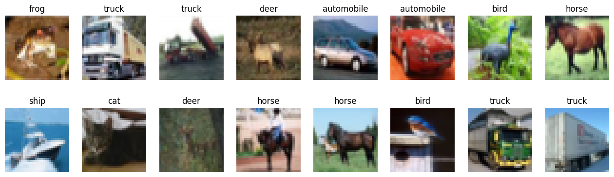
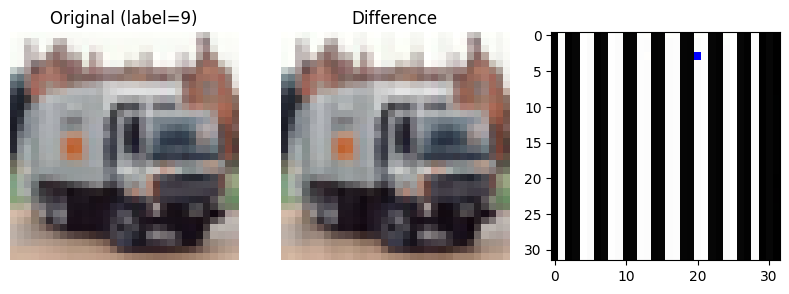
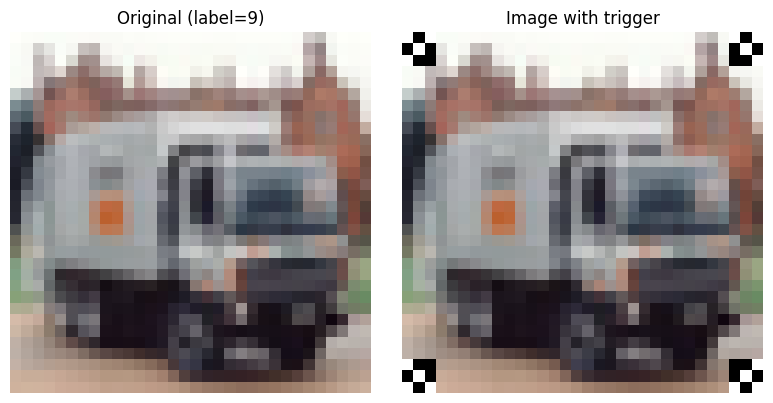
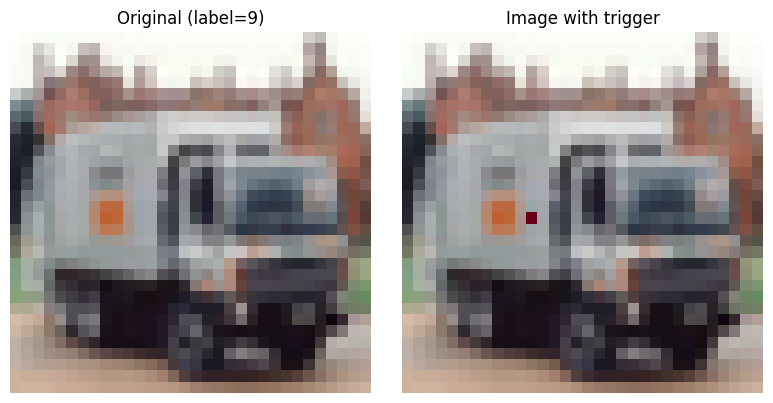
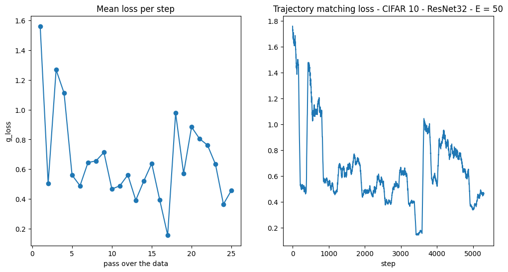
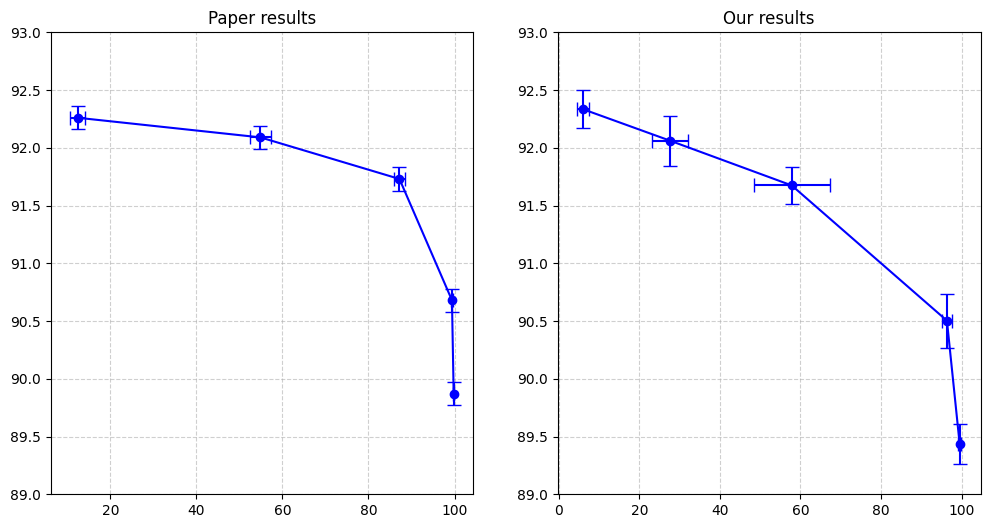

# Label Poisoning is all you need

## Dataset details
- Number of classes: 10
- CIFAR-10 = 50k images for training + 10k images for testing, equally distributed
- Image size = 32 x 32
```
['airplane', 'automobile', 'bird', 'cat', 'deer', 'dog', 'frog', 'horse', 'ship', 'truck']
```



**Baseline on the clean dataset**
- Settings : ResNet32, 30 epochs
- Training accuracy: 94.5%
- Test accuracy: 89.8%
- PTA accuracy: 10.4%

> PTA accuracy = $\frac{1}{N_{trucks}} \sum_{im \in test} 1_{y_{source}  = truck, f_{\theta}(T(im)) = y_{target}}$ where $T$ is the trigger and $f_{\theta}$ is the neural network


## Triggers
1. Sinusoidal trigger



2. Turner



3. Pixel



## FLIP algorithm
**Loss function**

$\mathcal{L}_{\text{param}}(\theta_{k+1}, \phi_{k+1}) = \frac{\Vert{} \theta_{k+1} - \phi_{k+1} \Vert{}^2}{\Vert{} \theta_{k+1} - \theta_k \Vert{}^2}$


$
\begin{aligned} \theta_{k+1} &= \theta_k - \eta \nabla_\theta \mathcal{L}_{\text{expert}}(\theta_k, B_k) \quad ; \quad B_k = \text{poisoned data} \\ \phi_{k+1} &= \theta_k - \eta \nabla_\theta \mathcal{L}_{\text{expert}}(\theta_k, B'_k) \quad ; \quad B'_k = \text{clean images with } \tilde{\ell} \text{ labels} \end{aligned}
$


$
\begin{aligned} \mathcal{L}_{\text{param}} &= \frac{\eta^2 \Vert{} \nabla_\theta \mathcal{L}_{\text{expert}}(\theta_k, B_k) - \nabla_\theta \mathcal{L}_{\text{expert}}(\theta_k, B'_k) \Vert{}^2}{\eta^2 \Vert{} \nabla_\theta \mathcal{L}_{\text{expert}}(\theta_k, B_k) \Vert{}^2} \\ &= 1 + \frac{\Vert{} \nabla_\theta \mathcal{L}_{\text{expert}}(\theta_k, B'_k) \Vert{}^2}{\Vert{} \nabla_\theta \mathcal{L}_{\text{expert}}(\theta_k, B_k) \Vert{}^2} - 2 \frac{\langle \nabla_\theta \mathcal{L}_{\text{expert}}(\theta_k, B_k) \, , \, \nabla_\theta \mathcal{L}_{\text{expert}}(\theta_k, B'_k) \rangle}{\Vert{} \nabla_\theta \mathcal{L}_{\text{expert}}(\theta_k, B_k) \Vert{}^2}\end{aligned}
$

Let's define 
$
R := \frac{\Vert{} \nabla_\theta \mathcal{L}_{\text{expert}}(\theta_k, B'_k) \Vert{}}{\Vert{} \nabla_\theta \mathcal{L}_{\text{expert}}(\theta_k, B_k) \Vert{}}
$

Cauchy-Schwarz inequality gives :

$$
\vert{}\langle \nabla_\theta \mathcal{L}_{\text{expert}}(\theta_k, B_k) \, , \, \nabla_\theta \mathcal{L}_{\text{expert}}(\theta_k, B'_k) \rangle\vert{} \le \Vert{} \nabla_\theta \mathcal{L}_{\text{expert}}(\theta_k, B'_k) \Vert{} . \Vert{} \nabla_\theta \mathcal{L}_{\text{expert}}(\theta_k, B_k) \Vert{}
$$

So,

$$
\begin{aligned} 1 + R^2 - 2R \le \;&\mathcal{L}_{\text{param}} \le 1 + R^2 + 2R \\ (1-R)^2 \le \;&\mathcal{L}_{\text{param}} \le (1+R)^2 \end{aligned}
$$

### Replicating the paper's results on CIFAR-10 with ResNet32 and the sinusoidal trigger

**Loss trajectory**

We look at the loss trajectory over the 25 steps, calculated with 50 experts


In each step, the algorithm starts from a different checkpoint, which explains the jumps in the trajectory. Each pass corresponds to an epoch, where the model goes over each batch and propagates the loss on the labels. Since every image appears one or twice in an epoch (once if it does not belong to the source class, and twice if it belongs to the source class), its corresponding vector class gets updated the same number of times. 

**Generated labels**

When the budget is $m=1000$, we observe that not all trucks get flipped into deer. Some trucks get flipped into other classes. And other classes get flipped into a truck as well.

| | -> airplane | -> automobile | -> bird | -> cat | -> deer | -> dog | -> frog | -> horse | -> ship | -> truck |
| :--- | :--- | :--- | :--- | :--- | :--- | :--- | :--- | :--- | :--- | :--- |
| **true airplane** | 4983 | 0 | 2 | 0 | 15 | 0 | 0 | 0 | 0 | 0 |
| **true automobile** | 0 | 4977 | 0 | 0 | 16 | 0 | 1 | 0 | 0 | 6 |
| **true bird** | 0 | 0 | 4984 | 0 | 16 | 0 | 0 | 0 | 0 | 0 |
| **true cat** | 0 | 0 | 0 | 4981 | 19 | 0 | 0 | 0 | 0 | 0 |
| **true deer** | 0 | 0 | 0 | 0 | 5000 | 0 | 0 | 0 | 0 | 0 |
| **true dog** | 0 | 0 | 0 | 0 | 15 | 4985 | 0 | 0 | 0 | 0 |
| **true frog** | 0 | 0 | 0 | 0 | 16 | 0 | 4984 | 0 | 0 | 0 |
| **true horse** | 0 | 0 | 0 | 0 | 12 | 0 | 0 | 4988 | 0 | 0 |
| **true ship** | 2 | 0 | 0 | 2 | 20 | 0 | 0 | 0 | 4975 | 1 |
| **true truck** | 1 | 79 | 14 | 23 | 683 | 3 | 17 | 28 | 9 | 4143 |

**Results**




# Next steps
- Reproduce more experiments on other datasets
- Test out a different loss function:
$$\mathcal{L}_{\text{param}}(\theta_{k+1}, \phi_{k+1}) = \cos{(\nabla_\theta \mathcal{L}_{\text{expert}}(\theta_k, B'_k), \nabla_\theta \mathcal{L}_{\text{expert}}(\theta_k, B_k))}$$
- Test out a different training paradigm: attempt to solve the optimization problem directly in GAN-style